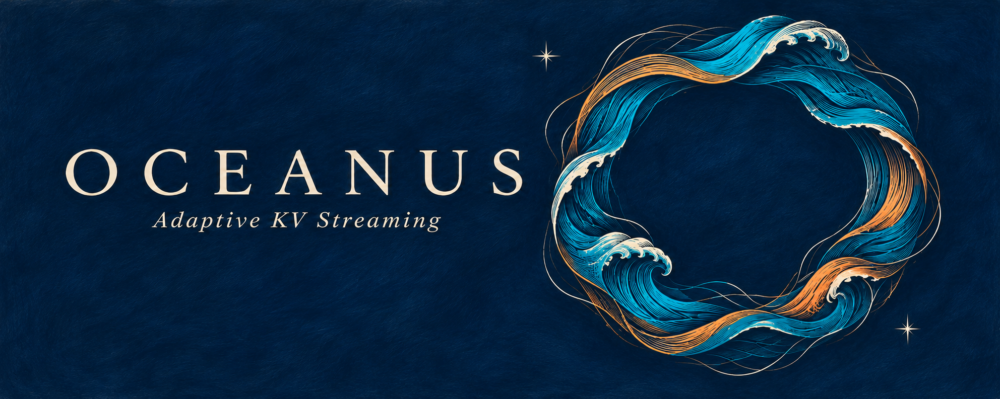
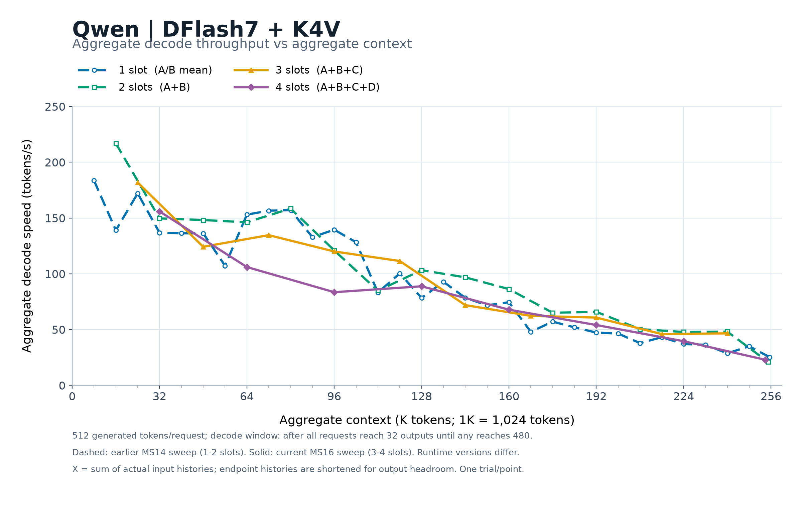
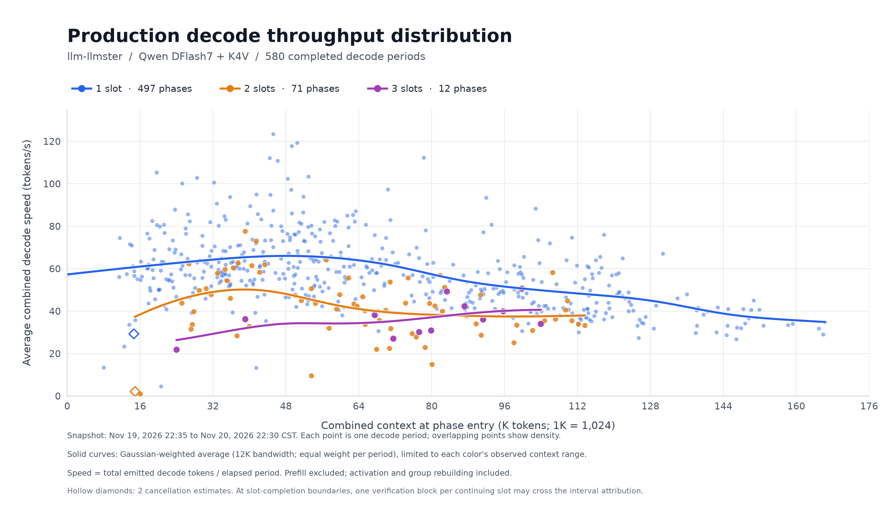
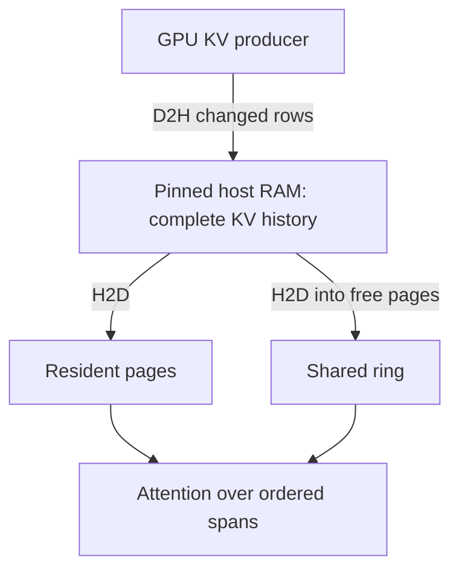
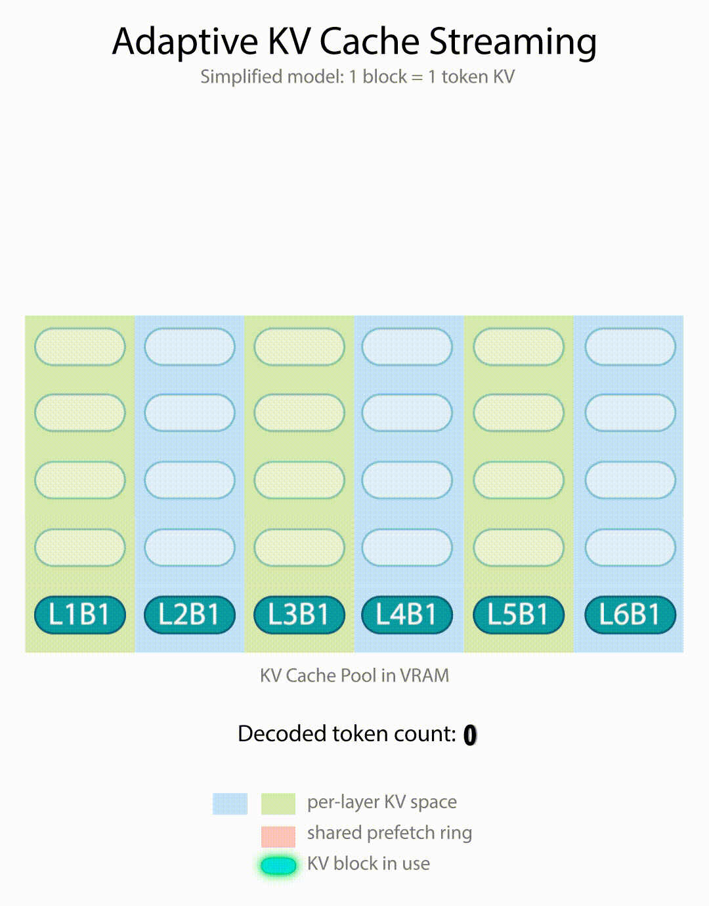
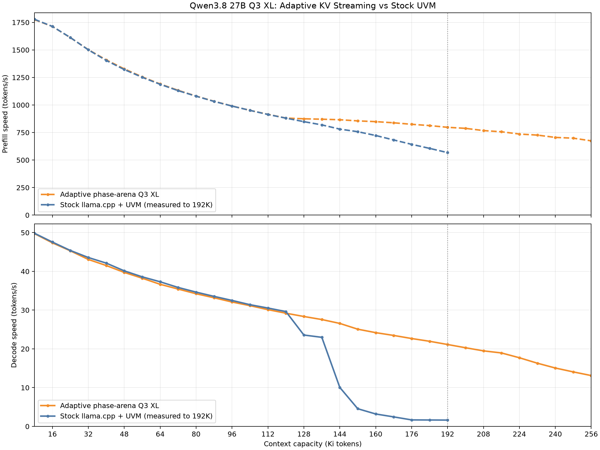
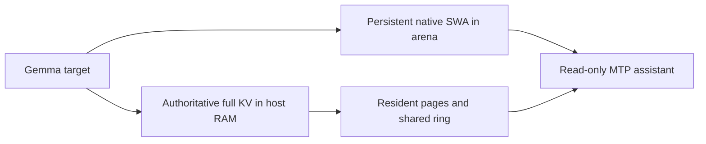
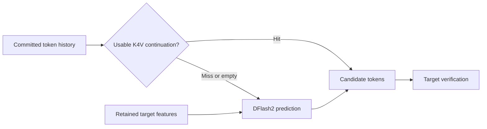

# Adaptive KV Cache Streaming V3 ("Oceanus")

**Oceanus keeps long histories flowing through limited VRAM.**

Named after the Greek Titan of the world-encircling river.

Oceanus, a fork of lamma.cpp, streams KV data through a reusable ring buffer. Full histories live in system RAM, while VRAM holds the portions needed for attention. One shared adaptive memory infrastructure supports target inference, speculative drafting, and multiple independent requests.



**Contents**

1. [What's new in V3](#whats-new-in-v3)
2. [Development history](#development-history)
3. [Supported Features](#supported-features)
4. [Quick Starts](#quick-starts)
5. [How it works](#how-it-works)

## What's new in V3

V3 serves multiple independent requests on one GPU through **batched prefill and parallel decode**. For decode, the memory policy manages the selected slots' combined per-layer KV working set using shared resident storage and a prefetch ring. Each request retains independent attention and state, and the scheduler keeps active selections within the context and memory budgets.

Both charts below were measured on one **RTX 5070 Ti (16 GB)** with **Qwen3.8-27B UD-IQ4_XS and Q8V4 KV**. Their horizontal axes show combined context across active slots; their vertical axes show aggregate decode throughput.

### SWE benchmark: one to four slots



Different SWE histories run concurrently, with 512 output tokens per request. The single-slot curve averages separate runs of histories A and B; the parallel curves measure the combined output of two, three, or four requests. The chart above uses DFlash2 with seven proposals plus K4V. Other modes: [target-only](media/oceanus-v3-swe-target-only-slots.png), [MTP with three proposals](media/oceanus-v3-swe-mtp3-slots.png), and [DFlash2 with seven proposals](media/oceanus-v3-swe-dflash2-slots.png).

<details>
<summary>SWE measurement notes</summary>

Throughput is measured over a common middle output window, after every request reaches 32 output tokens and until the first reaches 480. Runs use greedy sampling, one trial per point, and each execution path's fitted maximum arena minus 16 MiB. One- and two-slot curves come from the MS14 sweep; three- and four-slot curves come from MS16. These are historical measurements across revisions, rather than a controlled comparison that changes only the slot count.

</details>

### Real workload: Hermes with subagents

This production run included a Hermes agent delegating flight and Hyatt hotel research to two subagents for a trip. The server used DFlash2 with seven proposals plus K4V and supported up to three active slots.



Each point represents one decode period, colored by its active slot count. Its throughput is the total emitted decode tokens divided by that period's elapsed time. The matching curves show smoothed average throughput across the observed context range for each color.

<details>
<summary>Production measurement notes</summary>

The chart covers the whole server-log capture from November 19-20, 2026 (CST), including startup probes and any other traffic; it is not filtered exclusively to the travel task. It contains 580 completed decode periods: 497 single-slot, 71 two-slot, and 12 three-slot. Two cancellation-adjacent estimates are marked with hollow diamonds.

Context is the combined logical history at period entry, excluding unused arena headroom. Unlike the SWE middle-window measurement, these rates include decode activation and regrouping overhead. Prefill and external tool waits are excluded. Curves use a Gaussian weighted mean with a 12K-token bandwidth, restricted to each color's observed context range. Different requests, output lengths, and draft acceptance rates make this a workload distribution rather than a controlled comparison of slot counts.

</details>

## Development history

| Version | Released | What changed |
| --- | --- | --- |
| [V1](https://www.reddit.com/r/LocalLLM/comments/1w0impd/breaking_vram_barrier_qwen_38_27b_at_262k_context/) | 2026-08-28 | Introduced adaptive KV streaming: keep full KV histories in system RAM and dynamically divide a bounded VRAM pool between resident KV and a shared prefetch ring. |
| [V2](https://www.reddit.com/r/LocalLLM/comments/1wt03zh/adaptive_kvcache_streaming_v2_full_context_mtp/) | 2026-09-29 | Integrated speculative drafting into the existing streaming infrastructure, sharing KV storage and reusing the same VRAM arena across prefill, drafting, and verification. |
| V3 ("Oceanus") | 2026-11-21 | Enabled parallel slots by packing their independent per-layer KV histories into a consecutive aggregate working set, mapped onto the shared resident KV pool and ring buffer. |

## Supported Features

Oceanus runs on one CUDA GPU. Model weights and KV-cache quantization are separate choices; select weights that leave room for the execution arena.

| Feature | Available configurations |
| --- | --- |
| Models | Qwen3.8-27B and Gemma 4 31B, with matching model-specific assistants and projectors where used. |
| KV cache | Q8V8 (`q8_0` / `q8_0`), Q8V4 (`q8_0` / `q4_0`), and Q4V4 (`q4_0` / `q4_0`), subject to compiled kernels and memory fit. |
| Image input | Optional matching `mmproj` for still images and interleaved image/text prompts. Text-only execution explicitly disables the projector. |
| Drafting | Target-only; MTP with 1-3 proposals on both models; DFlash2 with 1-7 proposals on Qwen; Qwen DFlash2 + CPU K4V with independently selected neural/copy lengths of 1-7. |
| Parallel requests | Configurable logical slots, one shared GPU arena, independent histories, and jointly executed selections that fit the context and memory budgets. |

Q8V8 and Q8V4 have full-model reference profiles. Q4V4 is available through the common KV reader, with narrower full-model qualification; availability is not evidence that every model/drafter/image combination has been qualified. GPU execution evidence covers selected one- to four-slot profiles. Larger configured counts and other GPUs need their own qualification; see the [qualification ledger](MULTI_SLOT_PHASE_ARENA_ROADMAP.md).

[CI build profiles and architecture-specific binary releases](.github/CI.md).

## Quick Starts

Build the command as you make each choice. Keep `CMD`, the server command, and `FIT`, the arena-finder command, side by side so the fitting workload matches the intended launch. Each step appends arguments to both where needed; the last step adds the measured memory limits and runs `CMD`.

The examples use argument arrays: `CMD+=(...)` in Bash and `$CMD += @(...)` in PowerShell. Arrays preserve paths containing spaces and execute directly. Choose once at each step; start again from initialization if you change an earlier choice. Begin in a clean terminal without inherited `LLAMA_ARG_*`, UVM, or graph/rollback debug overrides, and keep that terminal open through the steps below.

Use a [CUDA server build](docs/build.md#cuda) and matching libraries from this fork, Python 3.10 or newer, and local model files. Run these commands from the repository root. Prepare the Python environment once; the local GGUF package supplies the finder's reader dependencies.

Linux:

```bash
python3 -m venv .venv
./.venv/bin/python -m pip install ./gguf-py
```

Windows:

```powershell
py -3 -m venv .venv
.\.venv\Scripts\python.exe -m pip install .\gguf-py
```

Initialize the two commands for your shell. Replace the server path with your actual executable. Both commands use the same batch sizes, localhost port, and logging level.

Bash:

```bash
CMD=('./build/bin/llama-server'
     --n-gpu-layers 999 --flash-attn on --fit off
     --batch-size 256 --ubatch-size 256
     --host 127.0.0.1 --port 1249 --offline --no-context-shift
     --cache-ram 0 -lv 4)
FIT=('./.venv/bin/python' benchmarks/find-max-arena.py
     --server "${CMD[0]}" --batch-size 256 --ubatch-size 256
     --port 1249 --verbosity 4 --decode-tokens 256
     --probe-mode preflight --validate-selected)
```

PowerShell:

```powershell
$CMD = @('C:\Oceanus\llama-server.exe',
    '--n-gpu-layers', '999', '--flash-attn', 'on', '--fit', 'off',
    '--batch-size', '256', '--ubatch-size', '256',
    '--host', '127.0.0.1', '--port', '1249', '--offline', '--no-context-shift',
    '--cache-ram', '0', '-lv', '4')
$FIT = @('.\.venv\Scripts\python.exe', 'benchmarks/find-max-arena.py',
    '--server', $CMD[0], '--batch-size', '256', '--ubatch-size', '256',
    '--port', '1249', '--verbosity', '4', '--decode-tokens', '256',
    '--probe-mode', 'preflight', '--validate-selected')
```

### 1. Choose the target model

| Target | Files to prepare |
| --- | --- |
| Qwen3.8-27B | Target GGUF; choose one containing the embedded MTP tensors if you want MTP. DFlash2 needs its matching separate sidecar. |
| Gemma 4 31B | Target GGUF; MTP needs its matching external assistant. Leave `--swa-full` off. |

Append your target path. The Qwen path below is an example; substitute your Gemma target when selecting Gemma. Reference file identities are recorded in the [Qwen DFlash2](benchmarks/data/dflash2-qwen27b-artifacts.json) and [Gemma](benchmarks/data/gemma4-31b-artifacts.json) manifests.

Bash:

```bash
OCEANUS_MODEL='/path/to/Qwen3.8-27B-with-MTP.gguf'
CMD+=(--model "$OCEANUS_MODEL")
FIT+=(--model "$OCEANUS_MODEL")
```

PowerShell:

```powershell
$OceanusModel = 'C:\Models\Qwen3.8-27B-with-MTP.gguf'
$CMD += @('--model', $OceanusModel)
$FIT += @('--model', $OceanusModel)
```

### 2. Choose the KV-cache precision

| Choice | K type | V type | Memory tradeoff |
| --- | --- | --- | --- |
| Q8V8 | `q8_0` | `q8_0` | Largest cache footprint of these choices. |
| Q8V4 | `q8_0` | `q4_0` | Smaller values; the main benchmark reference. |
| Q4V4 | `q4_0` | `q4_0` | Smallest footprint; validate quality for your workload. |

Set the two types, then append them. Adaptive drafting inherits this pair; separate draft-cache type overrides are rejected.

Bash:

```bash
OCEANUS_K=q8_0
OCEANUS_V=q4_0
CMD+=(--cache-type-k "$OCEANUS_K" --cache-type-v "$OCEANUS_V")
FIT+=(--cache-type-k "$OCEANUS_K" --cache-type-v "$OCEANUS_V")
```

PowerShell:

```powershell
$OceanusK = 'q8_0'
$OceanusV = 'q4_0'
$CMD += @('--cache-type-k', $OceanusK, '--cache-type-v', $OceanusV)
$FIT += @('--cache-type-k', $OceanusK, '--cache-type-v', $OceanusV)
```

### 3. Choose whether to enable image input

Leave the projector path empty for text only, or set it to the matching projector to enable images. Use Qwen's matching F16 projector. The qualified Gemma image profile uses a Q3_K_S target and matching Q8_0 projector, separate from its Q3_K_M text profile. Audio and video are outside this scope.

Bash:

```bash
OCEANUS_MMPROJ=''  # Or '/path/to/matching-projector.gguf'.
if [[ -n "$OCEANUS_MMPROJ" ]]; then
    CMD+=(--mmproj "$OCEANUS_MMPROJ")
    FIT+=(--mmproj "$OCEANUS_MMPROJ")
else
    CMD+=(--no-mmproj)
fi
```

PowerShell:

```powershell
$OceanusMMProj = ''  # Or 'C:\Models\matching-projector.gguf'.
if ($OceanusMMProj) {
    $CMD += @('--mmproj', $OceanusMMProj)
    $FIT += @('--mmproj', $OceanusMMProj)
} else {
    $CMD += '--no-mmproj'
}
```

The finder will check image shapes and supply fitted image limits in step 7. Multiple images or different workloads can require another fit.

### 4. Choose the drafting mode

| Choice | Target | Supported proposal length | Extra file |
| --- | --- | --- | --- |
| Target only | Both | None | None. |
| MTP | Qwen | 1-3 | Embedded MTP tensors in the target. |
| MTP | Gemma | 1-3 | Matching external assistant. |
| DFlash2 | Qwen only | 1-7 | Matching DFlash2 sidecar. |
| DFlash2 + K4V | Qwen only | Neural and copied lengths independently 1-7 | The same sidecar, retained for fallback. |

Open and apply **one** mode below. Gemma + DFlash2, Gemma + DFlash2/K4V, and simultaneous MTP + DFlash2 are unsupported. A longer draft is not necessarily faster.

<details>
<summary>Target only</summary>

Bash:

```bash
CMD+=(--spec-type none)
FIT+=(--spec-mode none --draft-length 0)
```

PowerShell:

```powershell
$CMD += @('--spec-type', 'none')
$FIT += @('--spec-mode', 'none', '--draft-length', '0')
```

</details>

<details>
<summary>MTP: Qwen or Gemma, 1-3 proposals</summary>

Bash:

```bash
OCEANUS_LENGTH=3
CMD+=(--spec-type draft-mtp --spec-draft-n-max "$OCEANUS_LENGTH"
      --spec-draft-n-min 0 --spec-draft-p-min 0)
FIT+=(--spec-mode mtp --draft-length "$OCEANUS_LENGTH")
```

PowerShell:

```powershell
$OceanusLength = 3
$CMD += @('--spec-type', 'draft-mtp', '--spec-draft-n-max', $OceanusLength,
    '--spec-draft-n-min', '0', '--spec-draft-p-min', '0')
$FIT += @('--spec-mode', 'mtp', '--draft-length', $OceanusLength)
```

For Gemma, also append the external assistant using the extra-file step below. Qwen's embedded MTP needs no separate draft file.

</details>

<details>
<summary>DFlash2: Qwen only, 1-7 proposals</summary>

Bash:

```bash
OCEANUS_LENGTH=7
CMD+=(--spec-type draft-dflash --spec-draft-n-max "$OCEANUS_LENGTH"
      --spec-draft-n-min 0 --spec-draft-p-min 0)
FIT+=(--spec-mode dflash --draft-length "$OCEANUS_LENGTH")
```

PowerShell:

```powershell
$OceanusLength = 7
$CMD += @('--spec-type', 'draft-dflash', '--spec-draft-n-max', $OceanusLength,
    '--spec-draft-n-min', '0', '--spec-draft-p-min', '0')
$FIT += @('--spec-mode', 'dflash', '--draft-length', $OceanusLength)
```

Also append the matching Qwen sidecar using the extra-file step below.

</details>

<details>
<summary>DFlash2 + K4V: Qwen only, neural/copied lengths 1-7</summary>

Bash:

```bash
OCEANUS_LENGTH=7
OCEANUS_COPY_LENGTH=7
CMD+=(--spec-type ngram-map-k4v,draft-dflash
      --spec-draft-n-max "$OCEANUS_LENGTH" --spec-draft-n-min 0 --spec-draft-p-min 0
      --spec-ngram-map-k4v-size-n 12 --spec-ngram-map-k4v-size-m "$OCEANUS_COPY_LENGTH"
      --spec-ngram-map-k4v-min-hits 2)
FIT+=(--spec-mode dflash-k4v --draft-length "$OCEANUS_LENGTH"
      --ngram-n 12 --ngram-m "$OCEANUS_COPY_LENGTH" --ngram-min-hits 2)
```

PowerShell:

```powershell
$OceanusLength = 7
$OceanusCopyLength = 7
$CMD += @('--spec-type', 'ngram-map-k4v,draft-dflash',
    '--spec-draft-n-max', $OceanusLength, '--spec-draft-n-min', '0', '--spec-draft-p-min', '0',
    '--spec-ngram-map-k4v-size-n', '12', '--spec-ngram-map-k4v-size-m', $OceanusCopyLength,
    '--spec-ngram-map-k4v-min-hits', '2')
$FIT += @('--spec-mode', 'dflash-k4v', '--draft-length', $OceanusLength,
    '--ngram-n', '12', '--ngram-m', $OceanusCopyLength, '--ngram-min-hits', '2')
```

Also append the matching Qwen sidecar below. N12/M7/H2 is a starting configuration: lookup-key length 12, copied maximum 7, and minimum hits 2. K4V is a CPU token-history lookup, not Q4 KV precision. With images, it looks up only text after the latest image. The target verifies every proposal.

</details>

**Extra file: required for Gemma MTP and both Qwen DFlash2 modes.** Skip this block for target-only and Qwen embedded MTP.

Bash:

```bash
OCEANUS_DRAFT_MODEL='/path/to/matching-assistant-or-DFlash2.gguf'
CMD+=(--model-draft "$OCEANUS_DRAFT_MODEL" --spec-draft-ngl 999)
FIT+=(--model-draft "$OCEANUS_DRAFT_MODEL")
```

PowerShell:

```powershell
$OceanusDraftModel = 'C:\Models\matching-assistant-or-DFlash2.gguf'
$CMD += @('--model-draft', $OceanusDraftModel, '--spec-draft-ngl', '999')
$FIT += @('--model-draft', $OceanusDraftModel)
```

**Optional: keep Qwen rollback snapshots in RAM.** Speculative verification retains recurrent-state snapshots so it can restore a rejected prefix. These stay on the native backend by default (VRAM with CUDA offload). Their footprint grows with draft depth and the number of selected slots, which can reduce the number of requests that decode together in a small arena. To reduce that footprint, append the following to both commands; transfers may reduce decode speed. This changes rollback snapshots only, not live recurrent state or attention KV. Refit the arena whenever you change this choice. Gemma has no recurrent rollback state.

Bash:

```bash
CMD+=(--recurrent-rollback-ram)
FIT+=(--recurrent-rollback-ram)
```

PowerShell:

```powershell
$CMD += '--recurrent-rollback-ram'
$FIT += '--recurrent-rollback-ram'
```

### 5. Choose slots and the context budget

Use one slot for one request, or start with two to four for concurrent clients. The build accepts 1-256 logical slots; actual joint execution depends on batching, model state, context, and arena capacity.

In adaptive multi-slot mode, the context limit caps both one request and the combined histories of a selected group. A 131,072-position budget can hold two roughly 60K histories plus output headroom, but not two 100K histories together. Requests can remain in RAM and execute in smaller groups. Images, generated tokens, and speculative headroom count too.

Bash:

```bash
OCEANUS_SLOTS=2
OCEANUS_CONTEXT=131072
CMD+=(--parallel "$OCEANUS_SLOTS" --ctx-size "$OCEANUS_CONTEXT")
FIT+=(--parallel "$OCEANUS_SLOTS" --context-size "$OCEANUS_CONTEXT")
if (( OCEANUS_SLOTS > 1 )); then
    CMD+=(--kv-unified)
fi
```

PowerShell:

```powershell
$OceanusSlots = 2
$OceanusContext = 131072
$CMD += @('--parallel', $OceanusSlots, '--ctx-size', $OceanusContext)
$FIT += @('--parallel', $OceanusSlots, '--context-size', $OceanusContext)
if ($OceanusSlots -gt 1) {
    $CMD += '--kv-unified'
}
```

The actual server option is **`--kv-unified`**. It is required for multiple adaptive slots; the finder also enables it for its probes automatically.

### 6. Fit the selected configuration

All feature choices are now represented in `CMD` and `FIT`. Free the GPU from competing workloads before fitting. The finder clears inherited overrides for its probes; keep them disabled for the final launch too.

**Windows prerequisite:** in NVIDIA Control Panel, open **Manage 3D settings > Program Settings**, add the exact `llama-server.exe` in `$CMD[0]`, and set **CUDA - Sysmem Fallback Policy** to **Prefer No Sysmem Fallback**. Apply this before probe processes start. Configure the server executable, not Python. This lets oversized device allocations fail during fitting instead of silently spilling into system memory; Oceanus's intentional host KV remains available. The finder cannot verify this setting. [NVIDIA instructions](https://nvidia.custhelp.com/app/answers/detail/a_id/5490).

Choose a new output directory, then run `FIT`:

Bash:

```bash
OCEANUS_OUTPUT='./arena-fit'
FIT+=(--output "$OCEANUS_OUTPUT")
"${FIT[@]}"
```

PowerShell:

```powershell
$OceanusOutput = '.\arena-fit'
$FIT += @('--output', $OceanusOutput)
$OceanusFitArgs = @($FIT | Select-Object -Skip 1)
& ($FIT[0]) @OceanusFitArgs
if ($LASTEXITCODE -ne 0) { throw 'Arena fitting did not complete successfully.' }
```

The search uses bounded probes, then validates the full requested workload at the selected size. Oversized trial allocations can fail as part of the search. Continue after a successful result; check `max_observed_text_decode_selection` in `result.json` for the intended joint slot count. Long-context validation can take several minutes.

### 7. Append the fitted limits and run CMD

After successful validation, the finder ends with a selected command. For example, this excerpt shows an arena size of **2048 MiB**:

```text
Selected command (posix):
/path/to/llama-server ... --shared-device-memory-mib 2048 ...
```

On Windows the heading is `Selected command (powershell):`. **Copy the number immediately after `--shared-device-memory-mib`.** The same number is saved as `arena_mib` in `result.json`.

Append it to the command you have been building. **Replace 2048 below with the value from your own run**; these example numbers are not recommended arena sizes.

Bash:

```bash
CMD+=(--shared-device-memory-mib 2048)
```

PowerShell:

```powershell
$CMD += @('--shared-device-memory-mib', '2048')
```

**If images are enabled**, also copy the exact `--image-min-tokens` and `--image-max-tokens` values from the selected command. For example:

```text
... --mmproj /path/to/projector.gguf --image-min-tokens 64 --image-max-tokens 256
```

Using the values from your own run, append both limits. Skip this addition for text-only execution.

Bash:

```bash
CMD+=(--image-min-tokens 64 --image-max-tokens 256)
```

PowerShell:

```powershell
$CMD += @('--image-min-tokens', '64', '--image-max-tokens', '256')
```

Your command is now complete. Run it:

Bash:

```bash
"${CMD[@]}"
```

PowerShell:

```powershell
$OceanusServerArgs = @($CMD | Select-Object -Skip 1)
& ($CMD[0]) @OceanusServerArgs
```

The server now starts with your assembled arguments and fitted memory limits. Both examples use localhost port 1249; change it in both initial commands before fitting if needed. Rebuild and refit after changing weights, cache precision, image budgets, drafting, slots, context, or batching.

## How it works

On a midrange graphics card with 10-16 GB of VRAM, fitting a quantized 25-30B dense model is only the first step. Its weights leave limited room for computation and the KV cache, which stores attention history and grows with the conversation. A model can fit at short context yet exhaust VRAM as an agent accumulates messages, code, and tool results.

Oceanus keeps full-attention histories in system RAM and explicitly stages their data into VRAM, while attention computation stays on the GPU. This makes long context practical without requiring the entire KV cache to be GPU-resident. The model weights, minimum workspace, and other device state still need to fit the card; weight quantization and available system RAM matter. The [original project story](https://medium.com/@raymond860909/running-qwen-27b-on-16g-vram-with-full-context-length-building-adaptive-kv-cache-streaming-for-bf1e819116e9) describes the progression from CUDA Unified Memory experiments to explicit streaming.

### 1. Adaptive KV streaming

Full attention reads a layer's growing KV history whenever that layer runs. These accesses are predictable: while the GPU computes one layer, the copy queue can prepare data for a later layer. Oceanus uses that ordering to overlap transfers with useful computation, rather than relying on page faults to discover which data is missing.

The two supported models use the same streaming infrastructure, with different cache topologies:

| Target | Histories handled by full-attention streaming | Other attention state |
| --- | --- | --- |
| Qwen3.8-27B | 16 full-attention layers | 48 recurrent/linear-attention blocks with their own state |
| Gemma 4 31B | 10 full-attention layers | 50 bounded sliding-window attention (SWA) caches, kept resident |

Only the full-attention histories grow with the complete context. Gemma's SWA caches retain their native local windows; they do not acquire a second full-length host history.

#### Where KV lives

The complete encoded full-attention K/V history is authoritative in **pinned system RAM**. It uses the selected KV precision, such as Q8V4. Host address ranges are reserved for the configured histories, while physical backing and registration grow with demand. Device storage is divided into **resident KV**, which stays available across layer visits, and a **shared ring**, which temporarily holds streamed portions. A page contains 256 token positions; its byte size depends on the K/V formats and model geometry.

For four illustrative layers, let `Ri` be layer `i`'s resident prefix and `Si` its streamed suffix:

```text
System RAM: complete histories
  Layer 1  [ R1 | S1 ]
  Layer 2  [ R2 | S2 ]
  Layer 3  [ R3 | S3 ]
  Layer 4  [ R4 | S4 ]

VRAM: KV portion of the arena
  Resident [ R1 | R2 | R3 | R4 ]
  Ring     [ reusable pages for streamed suffixes ]
```

The ring is shared across layers. It does not reserve one full suffix buffer for every layer. New KV rows are published back to the host history; unchanged historical pages do not need a device-to-host copy on every generated token. The diagram below shows how KV data moves between system RAM and VRAM:



H2D means host-to-device and D2H means device-to-host. Attention reads the resident and streamed spans in logical token order, including ring wrap-around. Physical placement does not change which history a query can attend to.

#### Following the ring through three time points

These snapshots illustrate a ring large enough to hold two suffixes. `A` and `B` name reusable regions for this example; they are not permanent per-layer allocations or a fixed double-buffer requirement. Resident prefixes remain in place throughout. Each snapshot shows work that may overlap, not equal-duration time steps.

**Time 1: layer 1 runs after its data is ready.** The initial uploads have supplied S1 and S2. Layer 1 reads R1 plus S1; S2 is available for the next layer.

```text
GPU compute  [ Layer 1 attention: R1 + S1 ]
Ring A       [ S1: being read             ]
Ring B       [ S2: ready                  ]
```

**Time 2: layer 1's last reader finishes.** Its region can now be overwritten. Layer 2 reads R2 plus S2 while the copy queue uploads S3 into region A.

```text
GPU compute  [ Layer 2 attention: R2 + S2 ]
Ring A       [ S3: uploading from RAM     ]
Ring B       [ S2: being read             ]
```

**Time 3: S3 is ready and layer 2 has released its region.** Layer 3 reads R3 plus S3 while region B receives S4. Layer 4 can then use R4 plus S4.

```text
GPU compute  [ Layer 3 attention: R3 + S3 ]
Ring A       [ S3: being read             ]
Ring B       [ S4: uploading from RAM     ]
```

A **ready fence** prevents attention from reading unfinished uploads. A **last-reader fence** prevents a copy from overwriting data still in use. If a transfer has not caught up, attention waits for the required spans; larger histories cannot always hide all PCIe traffic behind computation.

#### How the split adapts

When the history fits in resident storage, streaming is unnecessary. As it grows, the controller can stream selected layers and trade resident pages for a larger ring when prefetch misses its deadlines. More ring space allows earlier uploads, but leaves less history resident and increases transfer volume. The policy balances those costs within the same bounded allocation.

The animation follows resident KV, ring reuse, and repartition as context grows. Its simplified model uses six layers and one token per drawn block; actual streaming pages contain 256 token positions.



Animation from the [project article](https://medium.com/@raymond860909/running-qwen-27b-on-16g-vram-with-full-context-length-building-adaptive-kv-cache-streaming-for-bf1e819116e9).

Decode does not unconditionally reserve two complete streamed tails. The current tail can overlap with a partial next layer, and feedback can enlarge the ring further when needed. The same sizing policy sees the combined per-layer demand of selected slots, described below. Prefetch follows the next actual consumer, including a drafter handoff, rather than always assuming another target layer comes next.

Prefill has a related pipeline. For eligible wide, quantized attention, a bounded 2,048-token FP16 preparation stage reuses KV conversion across query tiles. Two alternating waves of the existing encoded ring let uploads overlap consumption; conversion and attention stay ordered on the compute queue. This preparation storage belongs to prefill scratch and is reclaimed for decode. Attention still covers the required history with the model's masks and ordered reduction path. The [qualification ledger](MULTI_SLOT_PHASE_ARENA_ROADMAP.md) records the scope of numerical and lifecycle checks.

#### Streaming versus stock Unified Memory



This target-only comparison from the project article uses an RTX 5070 Ti (16 GB), Qwen3.8-27B `UD-Q3_K_XL`, Q8_0 K / Q4_0 V, and 256 generated tokens per point. Streaming keeps decode throughput steadier once the cache exceeds available VRAM. The plotted adaptive implementation also includes phase-arena reuse, explained next. Stock measurements end at 192 Ki; the adaptive curve continues through 256 Ki.

The [original V1 streaming-only comparison](media/adaptive-kv-stream-v1-comparison.png) and its [measurements](media/adaptive-kv-stream-v1-comparison.csv) are also available. These historical Q3 results are separate from the IQ4 draft measurements in section 3. In these plots, `1 Ki = 1,024` token positions.

### 2. One arena, different phase layouts

Prefill processes many prompt tokens together and needs more graph tensor workspace than a small decode step. Drafting and image encoding also need workspace, but those peaks do not all execute at once. Oceanus lends regions of **one fixed device allocation**, the phase arena, to the active work. Image-bearing groups progress through **vision, prefill, then decode**; text-only groups skip vision.

**During vision**, the matching `--mmproj` projector and encoder workspace borrow arena space:

```text
Same arena, vision layout (schematic)
[ projector weights | encoder workspace | protected persistent state ]
```

Full-attention histories remain in system RAM, and protected regions such as Gemma's SWA caches remain intact. The encoder produces image embeddings in prompt order. Once encoding finishes, the projector weights and encoder workspace release their grants; the embeddings are retained for text prefill.

**During prefill**, the text layout is restored and prompt tokens, including the image embeddings, are processed with a larger compute workspace:

```text
Same arena, prefill layout (schematic)
[ larger prefill workspace | resident KV | ring | persistent state ]
```

**After the prefill-to-decode handoff**, unneeded workspace becomes available to the KV working set:

```text
Same arena, decode layout (schematic)
[ workspace | larger resident KV grant | ring | persistent state ]
```

The bars are not to scale. The KV grant includes both resident storage and the ring, whose split remains adaptive. Persistent regions, such as Gemma's SWA caches, are protected across handoffs. Complete full-attention histories remain in RAM, so a new device layout can refill them without recomputing the prompt.

| Allocation | Placement and reuse |
| --- | --- |
| Target weights and separate assistant/sidecar weights | Outside the arena; loaded models reduce how large an arena fits |
| Target prefill, target verification, and draft tensor workspace | Successive grants from the shared arena |
| Resident full-attention KV and shared ring | Use the active phase's admitted KV grant |
| Gemma SWA and bounded model-specific state | Protected or explicitly preserved across layout changes |
| Vision projector weights and controlled encoder workspace | Borrow arena regions for image encoding, then release them |
| Complete full-attention histories and K4V token lookup | System RAM |
| Driver/library bookkeeping and other native allocations | Accounted separately; the arena is not the total process footprint |

A handoff waits for affected readers and copies, preserves pending state, retires old device bindings, and installs the new layout before execution resumes. Reusing a device address does not make an old tensor view valid.

Image dimensions and batching affect the projector and encoder grants, so enabling vision requires fitting that configuration even though its temporary allocations are reused by later phases. See the [vision capacity guide](docs/multimodal/vision-capacity.md).

### 3. Drafting on the same streaming infrastructure

Speculative decoding proposes several tokens, then asks the target to verify a block. Accepted proposals reduce the number of expensive target passes per output token. The target remains responsible for verification; speed depends on proposal acceptance, draft cost, and the memory left for target KV.

The three draft paths have different history requirements:

| Drafter | KV source | How it shares memory |
| --- | --- | --- |
| Qwen embedded MTP | Its own full-length auxiliary KV history | Host-backed history, resident pages, and the same shared ring as the target |
| Gemma MTP assistant | Read-only views of the target's local and full-attention KV | No independent assistant KV history or KV catch-up |
| Qwen DFlash2 | A bounded 2,048-position draft window plus execution headroom, using target features | Bounded draft KV and workspace participate in arena ownership |

#### Qwen MTP: retain draft KV across predictions

Qwen's embedded MTP attention block has the same KV geometry and encoding as the target's full-attention layers. The common placement policy accounts for it as a **17th KV layer**, with its own host history. When the existing resident quota permits, the implementation prioritizes keeping this repeatedly read prediction cache resident. Otherwise, its nonresident suffix uses the ring.

The following snapshots show a round where an MTP suffix must be streamed. They describe successive uses of the same storage; they do not add another arena.

**Time 1: prepare the drafter.** After the last target readers release the required storage, MTP borrows workspace, obtains its resident prefix and streamed suffix, and catches up on verified target inputs.

```text
Resident KV  [ target prefixes | MTP prefix                 ]
Shared ring  [ MTP suffix: uploaded and ready               ]
Workspace    [ MTP catch-up on verified target inputs       ]
```

**Time 2: propose several tokens.** Sequential MTP predictions reuse the same valid KV spans. Newly written tail rows update the draft history; the unchanged suffix is not uploaded again for each candidate.

```text
Resident KV  [ target prefixes | MTP prefix                 ]
Shared ring  [ retained MTP suffix, with updated tail rows   ]
Workspace    [ MTP prediction 1, then 2, then 3              ]
```

**Time 3: hand storage back to the target.** After MTP's final reader, the ring can carry target suffixes again and the target verifies the candidate block. Prefetch may begin earlier wherever the ownership and readiness dependencies allow it.

```text
Resident KV  [ target prefixes | MTP prefix                 ]
Shared ring  [ target suffixes, refilled as layers advance   ]
Workspace    [ target verification of anchor and candidates ]
```

The accepted prefix is committed. A rejection also restores the matching recurrent state and truncates or replays the provisional suffix; changing KV length alone would be insufficient. Rollback snapshots stay on the native backend by default. With `--recurrent-rollback-ram`, host-backed candidates and bounded device staging reduce their VRAM footprint at the cost of transfers. Workspace, draft weights, active state, and transfers still cost memory and time. See [MTP design and qualification](MTP_ADAPTIVE_KV_ROADMAP.md).

#### Gemma MTP: borrow the target's KV

Gemma's matching four-block assistant reads the target's final local and full-attention sources. The target is the KV writer; the assistant does not append a separate history. The assistant reads these target-owned sources:



Full-attention source data can arrive in bounded waves when it cannot fit at once. Loaded spans are reused across predictions only while their source, generation, and logical coverage remain valid. The assistant and target verification take turns using workspace; the separate assistant weights remain loaded outside the arena.

#### DFlash2 and optional CPU K4V

DFlash2 consumes target features and maintains a bounded draft window, rather than another full-context cache. Its sidecar weights remain outside the arena. With K4V enabled, a token-history lookup in RAM can provide a continuation before neural prediction is attempted:



Commit and recovery follow target verification. A K4V hit skips neural prediction, but the target still verifies the proposal, required DFlash feature history is maintained for fallback, and the sidecar stays loaded. Rejected candidates are discarded and state is restored to the accepted prefix. K4V adds a host token lookup, not another GPU KV history, and is unrelated to Q4 KV precision. See the [DFlash2 + K4V guide](docs/development/dflash2-k4v.md).

#### Single-slot drafting performance

These recorded single-slot sweeps show how drafting changes prefill and decode throughput on an RTX 5070 Ti (16 GB), using Q8_0 K / Q4_0 V and 256 generated tokens per request. Each configuration uses its own fitted maximum arena. The horizontal axes show configured context capacity, including room for generation.

**Qwen3.8-27B, IQ4_XS weights:** target-only, MTP with three proposals, and DFlash2 with three or seven proposals.


At 128 Ki, this sweep measured 26.1 tokens/s target-only, 59.7 with MTP3, and 47.0 with DFlash2 at seven proposals. All four adaptive curves continue through 256 Ki. The gray stock-UVM curve is a separate target-only control ending at 128 Ki. [Adaptive measurements](media/adaptive-kv-four-mode-comparison.csv) / [stock-UVM measurements](media/stock-uvm-iq4-throughput.csv).

**Gemma 4 31B, Q3_K_M weights and matching Q8_0 MTP assistant:** target-only and MTP with one, two, or three proposals.


Target-only and MTP1/2 retain their measured 120 Ki endpoints. MTP3 comes from a separate revision with the D512 attention pipeline improvement and extends through 256 Ki, where it measured 7.8 tokens/s. The different revisions mean this is not a controlled measurement of draft length alone. [Measurements](media/gemma4-256ki-throughput.csv) / [measurement profiles](media/gemma4-256ki-throughput.json).

These are workload-specific reference measurements, rather than reruns of the current multi-slot implementation. Draft acceptance, weight encoding, and the KV budget available after loading the drafter all affect speed. See the [performance report](docs/development/adaptive-kv-performance.md) for methods and additional configurations.

### 4. Multi-slot aggregation

V3 extends the memory policy from one request's per-layer KV demand to the **combined demand of selected independent requests**. Model weights and the arena are shared. Each slot retains its own authoritative host histories, token positions, attention masks, speculative state, and output stream.

#### What is aggregated

For each attention layer, the mapping packs the selected slots' page-padded live KV ranges into an aggregate storage view. The resident/ring controller sizes that working set without treating every slot as another copy of the model's layers. Source-aware views retain ownership, so a query from slot A reads A's history and a query from slot B reads B's history.

For example, take three histories of 8K, 16K, and 24K tokens. Suppose this layer receives a 24K resident quota. A proportional page allocation gives resident prefixes of 4K, 8K, and 12K. RAM still contains each complete history:

```text
System RAM, independent histories for one attention layer
  Slot A  [ resident prefix:  4K | streamed suffix:  4K ]
  Slot B  [ resident prefix:  8K | streamed suffix:  8K ]
  Slot C  [ resident prefix: 12K | streamed suffix: 12K ]
```

If the ring can hold the full 24K combined suffix, the corresponding device working set can be represented as:

```text
VRAM, aggregate view for this layer
  Resident [ A: 4K | B: 8K | C: 12K ]  = 24K
  Ring     [ A: 4K | B: 8K | C: 12K ]  = 24K
```

Here `1K = 1,024` token positions. These are schematic token ranges; actual K/V planes, page padding, alignment, and ring wrap determine byte addresses. A smaller ring serves bounded waves. After the final readers release a range, its ring pages can carry another layer's data.

The controller uses the sum of page-padded live extents, rather than reserving a ring for every request. A slot's logical generation headroom is a scheduler allowance; it does not require an equally sized empty gap between live histories in VRAM. Packing does not create a concatenated host history or allow attention across requests.

#### How prefill and decode execute

Compatible prefill chunks from different slots are packed into the same native batch. The GPU processes their token rows through batched operations, with sequence-specific positions and masks. With a 256-token microbatch budget, two eligible slots can contribute 128 tokens each. Their total prompt lengths can differ; completed chunks are preserved as later chunks are scheduled.

During decode, the target processes query rows from the selected slots together. The shared transport prepares their combined per-layer KV working set, while attention views keep each request's readable ranges separate. Proposal lengths can differ by slot, so aggregate throughput depends on both useful batching and the amount of KV that must move. It is not the single-slot rate multiplied by the slot count.

#### Context budgets and reselection

The selected slots' combined histories and reserved generation headroom must fit `--ctx-size`; their execution must also fit the arena and native batch limits. Each request retains its own context limit. Unused context capacity is divided into logical growth allowances for the current selection.

When a slot exhausts its reserved growth allowance, or a selected request finishes or is cancelled, the scheduler re-evaluates the selection. It chooses a fitting subset of the current group with room to progress; growth can reduce how many slots fit. Unfinished slots left out are **parked**, with their histories and state preserved in RAM, and can resume at a later reselection. Parking neither discards history nor finishes a response.

#### Phase scheduling and new arrivals

The scheduler forms a **request group** and serves its work through ordered phases: **image encoding, prefill, then decode**. Arena space is reused at the phase boundaries; image encoding is skipped for text-only groups. A phase finishes its current work before the next begins, rather than switching on a timer.

| Phase | Execution and admission |
| --- | --- |
| Image encoding | Prepare the current group's images before text prefill, using the shared arena. |
| Prefill | Batch tokens from compatible slots within the microbatch budget. A compatible text request in a spare slot can join at a completed microbatch boundary if resources admit it, preserving work already completed. New requests requiring image encoding wait for the next group. |
| Decode | Batch the selected, prepared slots using the aggregate KV layout. New requests wait for the next group; they do not join when a slot becomes free. Already-prepared members parked by selection can resume at a decode reselection boundary. |

For example, if B arrives while A is prefilling, the scheduler can admit B at the next safe boundary and batch subsequent prefill chunks from both. Decode begins after the group's prefill work finishes. If B arrives after decode has started, it waits for the next request group.

Decode reselection changes the active subset within the current group without returning to prefill. Once all group members finish or are cancelled, the scheduler admits the next waiting group. Configuring more slots therefore increases the available concurrency, while context, workspace, and transfer costs determine how many actually execute together.
