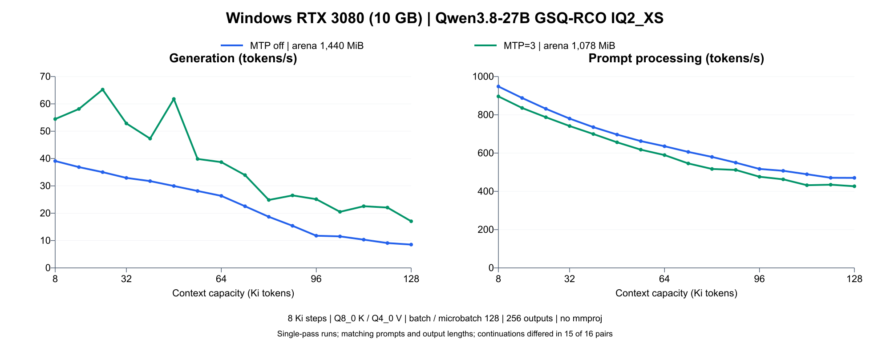

# Adaptive KV Streaming performance report

This report groups the recorded benchmarks by model, then separates implementation A/B studies and reproduction commands. The [README](../../README.md#performance-and-reproduction) keeps the short overview; [KV-cache support](../../README.md#kv-cache-formats) is a capability list, not a list of benchmarked context lengths.

## Reading the results

The earlier reference cohorts use an RTX 5070 Ti with 16,303 MiB of VRAM. The separately labelled Windows cohort uses an RTX 3080 with 10,240 MiB. Compare only the configurations and runtime cohorts stated for each experiment. Maximum-fit sweeps, fixed-arena A/B studies, stock-UVM controls and image-phase measurements answer different questions; they are not interchangeable samples of one curve.

Most sweep points are single retained measurements, not repeated statistical estimates. Independent maximum-fit arenas are not equal-memory comparisons between draft modes. Operator or fitting native controls establish numerical coverage separately; completion of a long streamed workload is not long-context native equivalence. Weight/KV quantization and draft acceptance can also change outputs or speed.

## Qwen3.8-27B measurements

### DFlash2 + K4V scheduling studies

The completed [bounded K7 support report](dflash2-k4v.md#measured-performance) separates two matched fixed-arena optimization studies from the older context curves. Flexible target prefetch improved the selected long DFlash7/mixed sample by 3.40%; restore overlap, over that fixed baseline, improved the selected 8K/64K samples by about 5.1-5.4%. These are separate single-pair cohorts, not additive gains or a rerun of the introductory sweep. Whole-call lookup studies and a separate six-context maximum-arena Open-SWE sample are indexed in [NK7 data](../../benchmarks/data/dflash2-k4v-nk7.json). K4V itself has no demonstrated broad natural-workload gain and remains opt-in.

### Natural Open-SWE branch comparison

The [nine-band main/current comparison](dflash2-k4v-swe.md) records 45 supported MTP3, DFlash7 and mixed K4V configurations from about 8 to 256 Ki of natural history. Same-mode branch decode changes are +0.6-2.6% for MTP3 and +2.0-6.2% for DFlash7, with prefill within 0.16%. Additional K4V gains are workload dependent; the unequal 192 Ki response is excluded from matched-work gains. This is a separate maximum-fit cohort, not a replacement for the article sweeps or the fixed-arena studies above.

### Stock UVM without KV streaming

The introduction adds a measured stock baseline using the same IQ4_XS weights, Q8_0 K / Q4_0 V and article corpus as the four-mode V2 sweep. Stock is pristine upstream revision `10a60cf303566e10d6a7a2774c17d2085503d87b`, the upstream base used by this V2 implementation. UVM is enabled for stock; there is no adaptive KV pool, phase arena, MTP, DFlash or host-rollback override. This is not the older Q3-weight measurement.

All 16 stock points from 8 through 128 Ki completed with 256 output tokens, one slot, b/ub=256, eight CPU threads and prompt length equal to context capacity minus 271. All stock output token IDs match the corresponding V2 target-only runs. The baseline ends at its last measured point; no stock performance is extrapolated to 256 Ki.

| At 128 Ki capacity | Stock + UVM | V2 streamed target-only |
| --- | ---: | ---: |
| Prefill | 837.1 tok/s | 934.6 tok/s |
| Decode | 2.48 tok/s | 26.15 tok/s |

The measured decode ratio at that point is about 10.6x; it is not a general speedup claim. At short contexts, stock decode is roughly 2-3% faster in this sweep. UVM migration can make performance uneven under pressure, so the plotted points are kept as measured rather than smoothed. [Stock-UVM measurements and configuration (CSV)](../../media/stock-uvm-iq4-throughput.csv).

### Q8/Q4 four-mode context scaling

The completed four-mode sweep measures target-only, MTP=3, DFlash2=3 and DFlash2=7 at every 8 Ki capacity from 8 Ki through 256 Ki: 32 points per mode, 128 total. It uses IQ4_XS weights, Q8/Q4 KV, the checked-in article corpus, one slot, b/ub=256, 256 generated tokens and 15 positions of headroom. Each mode/context independently uses its maximum-fit arena, without UVM or a safety reserve.


[All 128 plot points (CSV)](../../media/adaptive-kv-four-mode-comparison.csv). This is the earlier completed Q8/Q4 sweep, recorded before cache-format generalization. The later five-capacity Q8/Q4 regression checks in the matrix below retain identical arenas and output IDs, with throughput differences below 0.7%. The figures use their own recorded measurements; datasets are not mixed to fill missing modes or context points.

### Full-context comparison: KV formats and drafting modes

The recorded Qwen 45-point matrix uses the same Unsloth IQ4_XS target on an RTX 5070 Ti, context capacities 8/64/128/192/256 Ki, b/ub=256, one slot, 256 generated tokens and the [checked-in Wikipedia corpus](../../benchmarks/data/online-articles-262144-words.txt). Prompt length is capacity minus 271 positions. Each format, mode and context independently uses its maximum-fit arena, with UVM disabled and no safety reserve. This is separate from Gemma's Q8/Q4 60-point sweep and the newer fixed-budget prefill A/B cohorts.


[All 45 plot points (CSV)](../../media/kv-quant-comparison.csv)

| KV format at 256 Ki capacity | Target-only decode | MTP=3 decode | DFlash=7 decode |
| --- | ---: | ---: | ---: |
| Q8_0 / Q4_0 | 9.60 tok/s | 22.27 tok/s | 21.80 tok/s |
| Q8_0 / Q8_0 | 6.66 tok/s | 14.53 tok/s | 18.04 tok/s |
| Q5_1 / Q5_1 | 10.56 tok/s | 23.27 tok/s | 27.71 tok/s |

These are single-run measurements for this model, prompt and machine. Acceptance and memory pressure both affect speculative speed; DFlash is not always faster than MTP. Different K/V formats can change outputs, and this graph does not evaluate model quality.

All 15 Q8/Q4 comparisons with the pre-generalization build choose identical arenas and retain all 256 output token IDs. Decode differences are -0.67% to +0.57%; prefill differences are -0.11% to +0.20%. No material regression is observed; these small differences are not claimed as speed gains.

### Draft-length comparison at a fixed budget

This earlier experiment holds the parent at 2,240 MiB and compares embedded MTP lengths 0-3 with Q8/Q4. It is historical data, not another run of the maximum-fit matrix above.


[Detailed plot: pool size and acceptance](../../media/adaptive-kv-stream-v2-mtp-sweep.png). Fixed-arena and independently maximum-fit curves answer different questions: the latter includes differences in available resident KV space. Neither equal arena size nor equal KV grant means equal total VRAM across different draft models.

### Windows RTX 3080 text measurements

This is a separate native Windows/CUDA cohort using [ISTA-DASLab's pinned model revision](https://huggingface.co/ISTA-DASLab/Qwen3.8-27B-GSQ-RCO-GGUF/tree/d562806dbafae37109975e970aae91b43e73b440), file `Qwen3.8-27B-GSQ-RCO-IQ2_XS-mtp.gguf`. It contains 16 target-only and 16 embedded-MTP3 measurements from 8 to 128 Ki at 8 Ki steps. The Linux IQ4_XS cohorts above use different hardware, weights and budgets.



[Paired data (CSV)](../../media/qwen38-rtx3080-windows-iq2xs-throughput.csv) · [Profile, hashes and scope](../../media/qwen38-rtx3080-windows-iq2xs-throughput.json) · [Portable measurement records](../../benchmarks/data/windows-rtx3080-qwen38-iq2xs/results.jsonl) · [Selected fit and streaming evidence](../../benchmarks/data/windows-rtx3080-qwen38-iq2xs/evidence.json) · [Reproduction](#windows-rtx-3080-reproduction)

| Property | Recorded configuration |
| --- | --- |
| Machine | RTX 3080, 10,240 MiB VRAM; Core i9-14900K; 64 GiB system RAM |
| Runtime | Native Windows / WDDM, driver 610.88; CUDA 12.9 (NVCC 12.9.86); MSVC 14.35.32215; SM86 |
| Inference | One slot; all target layers offloaded; flash attention; Q8_0 K / Q4_0 V; batch/microbatch 128; eight CPU threads |
| Inputs | Checked-in article corpus, tokenized without added special tokens; prompt length = capacity minus 271 |
| Outputs | 256 tokens; temperature 0; seed 123; EOS ignored; prompt reuse disabled |
| Warmup | Fresh server per point; 256-token prompt and four outputs before the measured request |
| Speculation / modalities | Target-only or embedded MTP=3; no external assistant; no mmproj or image request; UVM off |

The arena was fitted **at 128 Ki for each mode**, then held fixed throughout that mode's sweep: target-only 1,440 MiB, MTP3 1,078 MiB. The adjacent 1 MiB-larger candidates were rejected. These are workload-specific fits under the available Windows GPU budget, without an arbitrary reserve. The target-only 128 Ki point reuses its successful full-workload arena-fit measurement; the other target-only points and all MTP3 points come from their fixed-arena sweeps. The arena-fit warmup and full request match the ordinary sweep protocol.

The producing executable and sweep-script hashes are recorded in the profile. Its source base is `bcf1a81d641c478db5690d2f2c048c691801fcb2` plus the [retained Windows arena patch](../../benchmarks/data/windows-rtx3080-qwen38-iq2xs/measurement-source.patch), which was uncommitted at measurement time. The later sweep-script Windows/UTF-8 and bandwidth-reference fixes are separate from these recorded timings. Documentation export re-renders existing points; it does not rerun or replace them.

| Capacity | Target-only prefill (tok/s) | MTP3 prefill (tok/s) | Target-only decode (tok/s) | MTP3 decode (tok/s) | Decode ratio |
| --- | ---: | ---: | ---: | ---: | ---: |
| 8 Ki | 948.14 | 896.21 | 39.09 | 54.45 | 1.39x |
| 16 Ki | 887.94 | 835.66 | 36.87 | 58.14 | 1.58x |
| 24 Ki | 831.43 | 787.31 | 35.02 | 65.23 | 1.86x |
| 32 Ki | 780.17 | 741.36 | 32.92 | 52.85 | 1.61x |
| 40 Ki | 735.47 | 699.55 | 31.75 | 47.29 | 1.49x |
| 48 Ki | 696.71 | 656.27 | 29.96 | 61.79 | 2.06x |
| 56 Ki | 662.54 | 617.73 | 28.14 | 39.85 | 1.42x |
| 64 Ki | 635.64 | 589.51 | 26.34 | 38.69 | 1.47x |
| 72 Ki | 606.10 | 545.82 | 22.55 | 33.94 | 1.51x |
| 80 Ki | 579.85 | 516.96 | 18.69 | 24.85 | 1.33x |
| 88 Ki | 549.93 | 511.94 | 15.40 | 26.52 | 1.72x |
| 96 Ki | 517.08 | 476.27 | 11.76 | 25.13 | 2.14x |
| 104 Ki | 507.30 | 462.75 | 11.52 | 20.51 | 1.78x |
| 112 Ki | 489.33 | 432.08 | 10.33 | 22.56 | 2.18x |
| 120 Ki | 470.91 | 434.81 | 9.09 | 22.07 | 2.43x |
| 128 Ki | 470.46 | 426.63 | 8.53 | 17.06 | 2.00x |

Generation throughput increased 1.33-2.43x with MTP3 in these measurements. Prompt processing was slower with MTP3. At 128 Ki, server-reported prompt plus generation time was **307.93 s target-only versus 321.54 s with MTP3** for the 130,801-token prompt and 256 outputs. This excludes model loading, tokenization and warmup; a decode-throughput gain is not the same measurement as full-request latency.

Each point is one retained measurement. Input prefixes and requested output lengths match, but generated continuations differ in 15 of 16 pairs. The mode-specific arena sizes also differ. This cohort measures observed throughput; numerical equivalence, long-context quality, repeated-trial uncertainty and a Windows-versus-Linux effect are not established by it.

#### Memory and streaming onset

| Mode | Last sampled decode without streaming | First sampled decode with streaming |
| --- | ---: | ---: |
| Target-only, 1,440 MiB arena | 48 Ki | 56 Ki |
| MTP3, 1,078 MiB arena | 32 Ki | 40 Ki |

The boundary logs change from `streaming=0` to `streaming=1`; the first streamed evaluations report 36.57 MiB target-only and 59.35 MiB with MTP3. These are per-evaluation byte counts, not MTP bytes per output token. An 8 Ki sampling interval brackets the onset rather than locating its exact token threshold. Initial cache uploads can occur below it. The retained capacity depends on the mode, arena, KV encoding and active workspace.

Peak sampled dedicated usage across the sweeps was about **9.51 GiB for the server** and **9.81 GiB across the GPU**. The NVIDIA **Prefer No Sysmem Fallback** setting was manually applied to the actual server executable before fitting, and probes restarted that executable. The driver profile was user-confirmed, not programmatically verified. The fork's complete host KV history in system RAM was allowed; mapped host KV can appear in shared GPU-memory counters. Those aggregate counters do not independently prove the residency of every allocation. These records qualify this text workload through 128 Ki, with Gemma, DFlash2, vision and larger contexts outside the Windows cohort.

#### Separate Windows PCIe check

A later profiling run on the same machine confirmed Gen4 x16 while transferring data. Five-trial pinned-copy tests measured best chunk-size medians of **23.52 GB/s host-to-GPU** and **23.82 GB/s GPU-to-host**, in decimal units. Large in-application KV reloads reached 23.21 GB/s target-only and 22.68 GB/s with MTP3. The profiled target-only decode rate and logged KV bytes imply about 17.62 GB/s of streamed KV payload, approximately 75% of the measured host-to-GPU reference. This estimate excludes other PCIe traffic and is not a literal bus-utilization counter.

NVML failed a known-byte calibration here: its raw receive readings implied roughly 41 GB/s during a separately timed 23.5 GB/s copy. The cause of the counter discrepancy was not established. Its literal bandwidth/utilization values were excluded, and no exact MTP3 average bus-utilization percentage is claimed. The legacy sweep's fixed-50-GB/s `h2d_util_pct` field is retained only in the raw historical records. The published throughput figure does not use it. PCIe profiling timings are a separate run and do not replace the sweep points. [PCIe summary and measurement limits](../../benchmarks/data/windows-rtx3080-qwen38-iq2xs/pcie-summary.json) · [Known-byte calibration trials](../../benchmarks/data/windows-rtx3080-qwen38-iq2xs/pcie-calibration.jsonl).

## Gemma 4 measurements

### Gemma 4 through 120 Ki

The final 60-point sweep covers every 8 Ki step from 8 to 120 Ki at target-only and MTP lengths 1-3. It uses the Q3_K_M target, matching Q8_0 assistant when enabled, Q8/Q4 KV, b/ub=256, UVM off and 256 outputs after a fresh capacity-minus-271-token prompt. Every point has its own full-workload maximum-fit arena and an actual rejected 1 MiB-larger neighbor.


[All 60 points (CSV)](../../media/gemma4-120ki.csv) · [Profile, hashes and qualification scope](../../media/gemma4-120ki.json)

| Capacity | Target-only decode | MTP1 | MTP2 | MTP3 |
| --- | ---: | ---: | ---: | ---: |
| 8 Ki | 39.61 | 67.68 | 81.50 | 91.16 |
| 64 Ki | 25.79 | 34.27 | 45.69 | 56.04 |
| 120 Ki | 10.33 | 16.97 | 22.70 | 28.26 |

Rates are tokens/s for this corpus and machine, with one measurement per mode/capacity. Independent maximum-fit arenas are 1,502-1,510 MiB target-only and 1,024-1,032 MiB with the assistant; its weights reduce the space left for the arena. This is not an equal-memory comparison or a statistical speedup claim. All 15,360 output IDs and counters are checked for completeness; native equivalence is established separately at fitting contexts and by exact operator/model controls. A successful 120 Ki workload is not a full-256-Ki qualification. The earlier stopped 128 Ki cohort is preserved separately, not mixed into this graph.

### MTP3 through 256 Ki

The separate Gemma MTP3 follow-up completed all 32 points from 8 through 256 Ki, using `find-max-arena.py` independently at every point and retaining each rejected+1 MiB neighbor. Its rates are published in the [introductory chart data](../../media/gemma4-256ki-throughput.csv), with [cohort provenance](../../media/gemma4-256ki-throughput.json); its local comparison with the historical120 Ki MTP3 series is audited in the [Gemma ledger](../../GEMMA4_ADAPTIVE_KV_ROADMAP.md). The historical all-mode120 Ki data and the image Q3_K_S cohort remain separate; this is not all-mode256 Ki or full-context vision qualification.


This overview preserves the earlier target-only/MTP1/MTP2 measurements through 120 Ki and uses the separate post-D512 MTP3 series through 256 Ki. It does not extrapolate missing modes, join two MTP3 cohorts into one line, or attribute every difference to drafting. Both throughput y-axes start at zero.

## Optimization comparisons

### Common prefill improvements

Two separate repeated A/B studies use fixed 1 GiB arenas, Q8/Q4, b/ub=256, UVM off and 256 outputs. Each has 52 fresh requests, three paired trials at 8/64 Ki for target-only/MTP3, plus single 120 Ki target-only controls. They compare successive adaptive implementations, **not stock UVM**; do not multiply different cohorts into an unmeasured combined speedup.

| Repeated 64 Ki prefill improvement | Gemma target-only / MTP3 | Qwen target-only / MTP3 |
| --- | ---: | ---: |
| Bounded conversion reuse vs pre-conversion adaptive | +32.44% / +32.12% | +5.14% / +5.23% |
| Two-wave pipeline vs conversion-only | +3.64% / +3.65% | +1.25% / +1.82% |

Paired prompts, output IDs and draft counts match; decode median differences stay within 0.17% for conversion and 0.15% for the pipeline. At 8 Ki, conversion gains are smaller and the incremental pipeline change is negligible. [Conversion CSV](../../benchmarks/data/prefill-conversion-v1.csv) / [profile](../../benchmarks/data/prefill-conversion-v1.json), [pipeline CSV](../../benchmarks/data/prefill-pipeline-v1.csv) / [profile](../../benchmarks/data/prefill-pipeline-v1.json).

Matched Nsight windows confirm the mechanism: at 96 Ki, H2D time overlapping observed GPU kernels increases from 3.2% to 86.6% for Gemma and 2.9% to 62.1% for Qwen, with reader/converter GPU interval unions roughly stable. These are clipped time-interval intersections, not SM occupancy, bandwidth or hardware counters. Instrumented throughput is not the speedup measurement; these original captures did not include Nsight Compute counters.

### D512 attention feature pipeline

The SM120 D512 resumable 8-by-8 attention path now double-buffers K/V feature chunks inside the GPU. It preserves the native MMA, softmax, reduction and checkpoint order. Eligibility follows geometry and capabilities, not the model name; Gemma is the full-model reference and Qwen D256 is the regression control.

The following fresh A/B screen compares the shipping conversion-plus-ring implementation with the D512 change. Both use a fixed 1 GiB arena, Q8/Q4 KV, b/ub=256, UVM off, uncached `capacity-271` prompts and 256 outputs. There is one pair per point, not a repeated statistical trial matrix.

| Gemma capacity / mode | Baseline prefill tokens/s | D512 pipeline prefill tokens/s | Prefill change | Decode change |
| --- | ---: | ---: | ---: | ---: |
| 8 Ki, target-only | 1324.05 | 1342.56 | +1.40% | +0.34% |
| 8 Ki, MTP3 | 1304.80 | 1322.29 | +1.34% | +0.14% |
| 64 Ki, target-only | 834.46 | 895.73 | +7.34% | +0.07% |
| 64 Ki, MTP3 | 826.07 | 887.00 | +7.38% | -0.16% |

All paired prompt/output IDs, draft counts and decode-pool layouts match. Qwen target-only controls at 8/64 Ki change by less than 0.1% in prefill and 0.4% in decode. [Measurements (CSV)](../../benchmarks/data/d512-feature-pipeline-v1.csv) / [profile and qualification (JSON)](../../benchmarks/data/d512-feature-pipeline-v1.json). Do not combine these fixed-arena rates with the independently fitted 120 Ki sweep as if they were one cohort.

The extra buffer is **16 KiB of on-chip shared memory**, not a device allocation or a larger arena minimum. Total user shared memory is 100,136 bytes against the measured 101,376-byte limit; exact-limit and one-byte-short admission are tested. The existing quantized prefill preparation still requires its separately documented 8/16 MiB arena stage. Dense-strided, encoded-direct, D256, other tiles and older architectures retain their previous paths.

Qualification includes all 64 K/V pairs, native-bit and frozen-checkpoint oracles, 120 focused mask/tail/wrapped-wave profiles, 120 native-matched server records, ASan/UBSan and 17 zero-error CUDA memcheck/racecheck/synccheck gates. Only the wide sanitizer fixture uses the user-approved 769 MiB arena; ordinary model execution remains 1 GiB. Two representative affected CUDA units also pass functional compilation for SM61/70/75/86; that is not physical older-GPU runtime qualification. Further model admission is independent of generic D512 kernel support.

## Reproducing text sweeps

Use a separate output directory for every run. No existing server or container is required: these commands start their own test servers. `--no-manage-production` disables the script's optional container-management integration. Make sufficient GPU memory available before running. The fixed-span script accepts a model path and configurable cache types:

```sh
python3 benchmarks/run-fixed-span-sweep.py \
  --server build-v2/bin/llama-server --model /path/to/Qwen3.8-27B-UD-IQ4_XS.gguf \
  --contexts 8192,65536,131072,196608,262144 --prompt-headroom 15 \
  --cache-type-k q8_0 --cache-type-v q4_0 --mtp-lengths 0,3 \
  --decode-tokens 256 --arena-mib 2240 --auto-max-arena \
  --no-manage-production --output benchmarks/results/text-q8-q4
```

For the completed Gemma grid, use the separate assistant and explicitly stop at 120 Ki:

```sh
python3 benchmarks/run-fixed-span-sweep.py \
  --server build-v2/bin/llama-server --model /path/to/gemma-4-31B-it-Q3_K_M.gguf \
  --model-draft /path/to/mtp-gemma-4-31B-it-Q8_0.gguf \
  --min-context 8192 --max-context 122880 --context-step 8192 \
  --mtp-lengths 0,1,2,3 --cache-type-k q8_0 --cache-type-v q4_0 \
  --batch-size 256 --ubatch-size 256 --decode-tokens 256 --prompt-headroom 15 \
  --auto-max-arena --request-timeout 3600 --no-manage-production \
  --output benchmarks/results/gemma-final-120ki
```

The external assistant is not loaded for length 0. Omit `--auto-max-arena` to keep a supplied arena fixed. The general script's default endpoint is still 256 Ki, so **keep Gemma's explicit 120 Ki endpoint** for this qualification. Keep `--no-manage-production` for standalone use; only the test processes launched by these commands are managed.

The DFlash control harness verifies the pinned target, sidecar and publisher config before running. It is deliberately an artifact-specific reproduction tool, unlike the general arena finder:

```sh
python3 benchmarks/run_dflash_controls.py \
  --server build-v2/bin/llama-server \
  --target /path/to/Qwen3.8-27B-UD-IQ4_XS.gguf \
  --draft /path/to/Qwen3.8-27B-DFlash2-Q4_K_M.gguf \
  --draft-config /path/to/DFlash2/config.json \
  --contexts 8192,65536,131072,196608,262144 --depths 3,7 \
  --prompt-tokens 262144 --prompt-headroom 15 --decode-tokens 256 \
  --target-k q8_0 --target-v q4_0 --arena-mib 1500 --auto-max-arena \
  --output benchmarks/results/dflash-q8-q4

python3 benchmarks/plot_dflash_controls.py \
  --series target-and-MTP benchmarks/results/text-q8-q4 \
  --series DFlash2 benchmarks/results/dflash-q8-q4 \
  --output benchmarks/results/speculation-comparison.png
```

For the dense four-mode sweep, pass all 32 capacities to both commands: in Bash, use `--contexts "$(seq -s, 8192 8192 262144)"`, retaining MTP lengths `0,3` and DFlash depths `3,7`. The plotting command combines both result directories without mixing in an earlier-build baseline.

Repeat with the other cache pairs and label each series accordingly. The control harness also supports `--spec-mode none --depths 0` and `--spec-mode mtp --depths 3`. It starts and cleans up its own test servers without requiring or managing another service. Its `--lifecycle` checks are separate from throughput measurement. The corpus is Wikipedia text under CC BY-SA 4.0 with article attribution, separate from the code license.

Correctness qualification compares matching formats and execution modes against native attention, including logits, hidden rows, KV bytes and recovery state. TG1 and multi-row stock kernels can themselves differ numerically; cross-mode output equality is not the numerical oracle. See [KV-format qualification](../../KV_QUANTIZATION_ROADMAP.md) and [the upstream attention port](../../UPSTREAM_ATTENTION_PORT_ROADMAP.md).

The Gemma command above reproduces the earlier all-mode 120 Ki cohort. To schedule only MTP3 through the native 256 Ki capacity, use `--mtp-lengths 3 --max-context 262144` with the matching external assistant. Use a new output directory and record the actual source, binaries, inputs and fitted arena at every point; a new run is a new cohort, not a replacement for the published records.

Full sweeps can take hours. They are distinct from the [quick arena-sizing examples](../../README.md#find-a-usable-arena-size), which use short runtime probes and optionally one final full-workload validation. Neither tool needs an existing inference service.

### Windows RTX 3080 reproduction

Use a native CUDA server build and Python 3.10 or newer; Matplotlib is optional for the sweep's plots. Set **Prefer No Sysmem Fallback** for the exact server executable in NVIDIA Control Panel before dedicated-VRAM fitting, then restart the server. Keep the designed host KV history in system RAM. The scripts print the policy requirement but do not verify it. See the [arena-fitting instructions](../../README.md#find-a-usable-arena-size).

The following PowerShell recipe refits the largest context separately for target-only and MTP3, then holds each winning arena fixed across its full range. Substitute the local executable and model paths; the timestamp gives every run a fresh destination. The measured 1,440/1,078 MiB grants are not portable recommendations.

```powershell
$python = 'C:\path\to\python.exe'
$server = 'C:\path\to\llama-server.exe'
$model = 'C:\models\Qwen3.8-27B-GSQ-RCO-IQ2_XS-mtp.gguf'
$run = Get-Date -Format 'yyyyMMdd-HHmmss'
$common = @(
  '--server', $server, '--model', $model,
  '--batch-size', '128', '--ubatch-size', '128',
  '--cache-type-k', 'q8_0', '--cache-type-v', 'q4_0',
  '--prompt-headroom', '15', '--decode-tokens', '256',
  '--no-manage-production'
)
foreach ($mode in 0, 3) {
  $fitDir = "benchmarks/results/windows-$run-fit-mtp$mode"
  & $python benchmarks/run-fixed-span-sweep.py @common `
    --contexts 131072 --mtp-lengths $mode --auto-max-arena `
    --arena-mib 1024 --output $fitDir
  if ($LASTEXITCODE -ne 0) { throw "Arena fitting failed for MTP=$mode" }
  $fit = Get-Content "$fitDir/results.jsonl" -Tail 1 -Encoding UTF8 | ConvertFrom-Json
  & $python benchmarks/run-fixed-span-sweep.py @common `
    --min-context 8192 --max-context 131072 --context-step 8192 `
    --mtp-lengths $mode --arena-mib $fit.arena_mib `
    --output "benchmarks/results/windows-$run-sweep-mtp$mode"
  if ($LASTEXITCODE -ne 0) { throw "Sweep failed for MTP=$mode" }
}
```

This recipe measures a fresh full sweep after fitting. The historical target-only dataset instead retained its full-fit 128 Ki request as that point; record which measurement is retained and do not count fit validation as an independent throughput replicate. A fresh run is a new cohort. The fixed-span script uses eight CPU threads and a 256-token/four-output warmup. For a fixed arena per mode, keep `--auto-max-arena` on the single-context fitting step only: adding it to the range refits every context independently.

For optional target-only KV-payload estimates, pass `--h2d-reference-gbps` with a known-byte pinned host-to-device measurement from the actual PC. The corrected scripts have no default 50 GB/s reference, and MTP payload percentages remain unknown without per-evaluation accounting. This is distinct from measuring all PCIe bus traffic.

## Image measurements

Qwen and Gemma share the vision launch/request mechanism, but their projector artifacts, positions, cache lifetimes and memory budgets differ. Image and text-only measurements must remain separately labelled. See the [Gemma vision report](../multimodal/gemma4-vision.md#phase-measurements) and [Qwen vision measurement instructions](../../tools/server/tests/README.md#vision-memory-and-handoff-measurements) for the image-specific records and reproduction scope.
